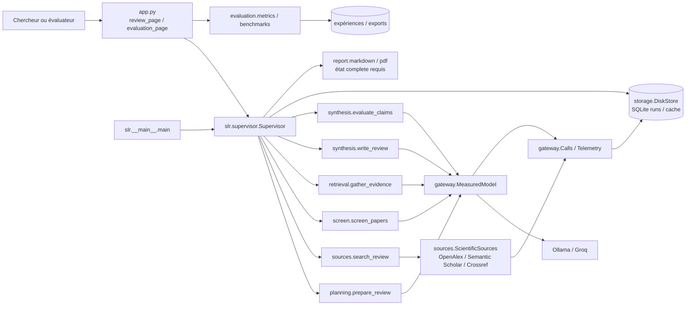
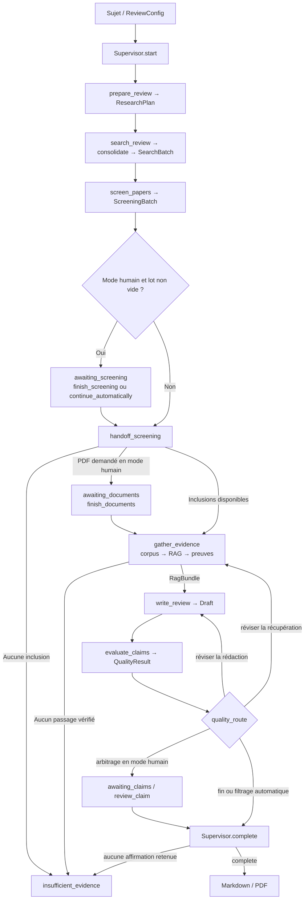
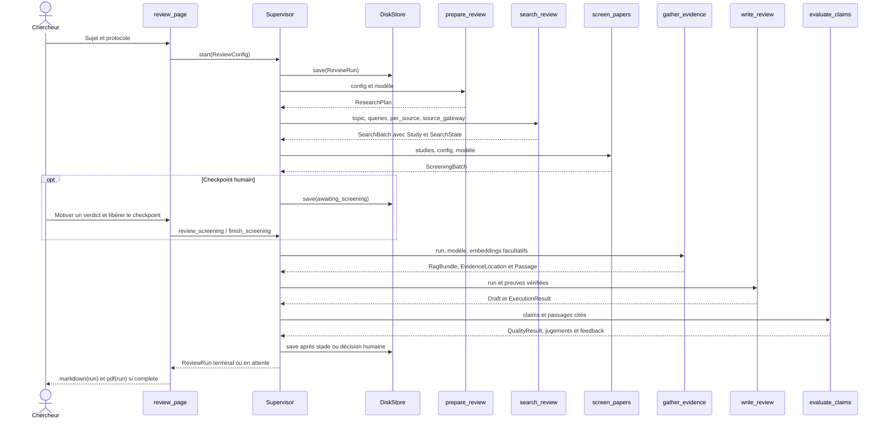
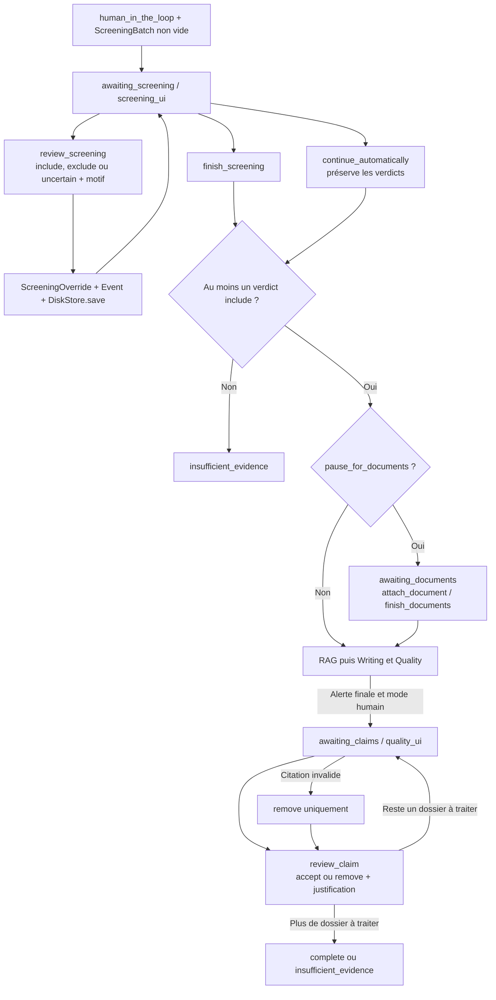
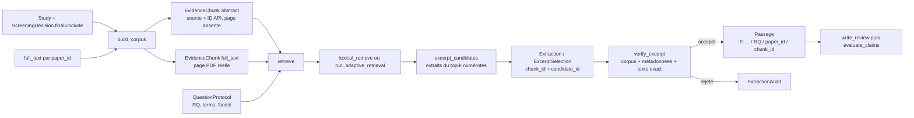
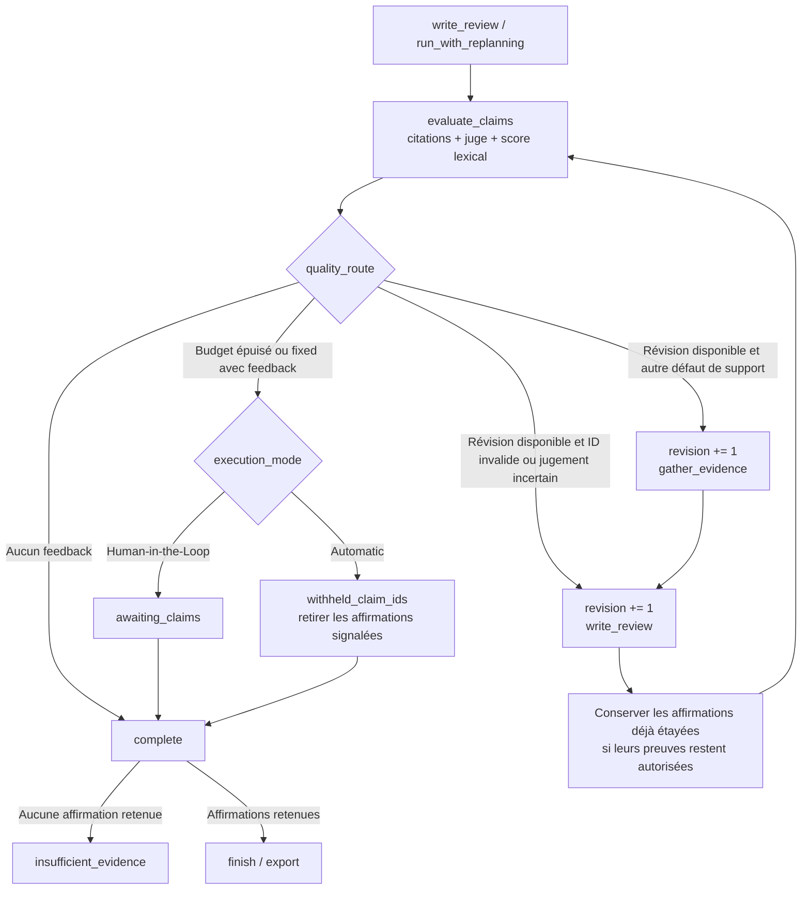

# Architecture et orchestration

MultiAgentSLR est un processus Streamlit dans lequel un superviseur Python appelle six rôles synchrones. Les rôles partagent un objet `ReviewRun` persistant et des contrats Pydantic. Les handoffs enregistrent les transitions et les artefacts. Le passage de données effectif lit les attributs de `ReviewRun`. La communication entre agents ne dépend d'aucun bus, message autonome ou microservice interne. Les appels externes concernent le fournisseur LLM, les API bibliographiques et, si configuré, les embeddings Ollama.

## 1. Composants

La flèche du superviseur vers `report` représente l'autorisation par l'état. Les entrées UI et CLI invoquent le rendu. Les éventuels embeddings empruntent `MeasuredEmbeddings` et `Calls`. [Entrée UI](../../app.py) · [Entrée CLI](../../slr/__main__.py) · [Gateway](../../slr/gateway.py)

## 2. Workflow et contrôle

La branche PDF n'est prise qu'après le handoff de screening si `pause_for_documents=True`. Des échecs attendus transforment le stade courant en `failed`. Le détail est enregistré même si aucune sortie finale ne peut être produite. [Supervisor](../../slr/supervisor.py)

## 3. Séquence nominale et contrats

## 4. Points de décision humains

[Workflow humain, éléments de preuve et tests](HITL_WORKFLOW.md)

## 5. RAG et provenance

## 6. Boucle de qualité

La garde de routage donne priorité à l'absence de feedback. `fixed` désactive les retours de correction de production et conserve la décision terminale selon le mode. La boucle TD08 expérimentale a ses propres états et budgets. [synthesis.py](../../slr/synthesis.py) · [orchestrator.py](../../slr/course/orchestrator.py) · [Ablations](BASELINES_AND_ABLATIONS.md)

## Coordination, reprise et déploiement

| Fonction | Comportement en production | Fichiers |
| --- | --- | --- |
| Ordonnancement | `advance` itère sur `next_stage` tant que `status=running`. `on_stage` alimente l'indicateur de progression Streamlit. Le modèle est instancié à la demande par séquence d'exécution | [supervisor.py](../../slr/supervisor.py), [app.py](../../app.py) |
| Contrats de passage | `Handoff` contient source, cible, objectif, artifact, identifiants de preuve, statut `ok/partial/blocked` et budget restant. `validate_handoff` exige une transition autorisée, preuves dans l'état et budget non négatif. L'ensemble de candidats au screening doit correspondre aux études découvertes. RAG ne peut transmettre que les études incluses | [quality_models.py](../../slr/course/quality_models.py), [orchestrator.py](../../slr/course/orchestrator.py), [supervisor.py](../../slr/supervisor.py) |
| Reprise et abstention | `retry` reprend l'étape échouée. `retry_retrieval` redémarre à `rag` après une preuve insuffisante à cet endroit, conserve search et screening et journalise une intervention. Le bouton Continue review peut reprendre un état `running` sauvegardé. Pas de reprise automatique des appels en cours après interruption du processus | [supervisor.py](../../slr/supervisor.py), [app.py](../../app.py) |
| Persistance | SQLite en WAL, version optimiste lors de `save` et horodatage UTC. `StaleRunError` signale une modification concurrente. Sauvegarde des textes de pages et des décisions, sans fichier PDF original dans l'état | [storage.py](../../slr/storage.py), [models.py](../../slr/models.py) |
| Cache | `Calls.use` consulte une clé SHA-256 incluant opération et identité. Le modèle y inclut fournisseur, modèle, endpoint le cas échéant, température, messages et schéma structuré. Le cache d'API repose sur URL, requête et limite. Seules les réponses réussies et validées alimentent le cache. Cache désactivable par TTL 0 | [gateway.py](../../slr/gateway.py), [sources.py](../../slr/sources.py) |
| Erreurs externes | Retry de transport borné à une tentative additionnelle pour l'API et les appels LLM, selon erreur temporaire et délai accepté. `Retry-After` numérique ou délai par défaut 0,25 s et plafond de 3 s pour le retry. Les observations donnent le statut final et les événements décrivent les tentatives | [gateway.py](../../slr/gateway.py), [runtime.py](../../slr/course/runtime.py) |
| Expériences | `run_benchmark` écrit inputs, outputs, prompts, événements et métadonnées avec hashes. Le CLI `--record-prompts` et les tests live documentent certaines exécutions. La session UI ordinaire conserve les artefacts d'étape et la télémétrie en base, sans capture intégrale des prompts | [benchmarks.py](../../evaluation/benchmarks.py), [__main__.py](../../slr/__main__.py), [test_live.py](../../tests/test_live.py) |
| Déploiement | Conteneur d'application unique, volume `review_data` et conteneur tests séparé. `slr.health` vérifie la santé HTTP Streamlit et l'accès SQLite en écriture. Render décrit un service, sans validation effective de déploiement cloud | [Dockerfile](../../Dockerfile), [compose.yaml](../../compose.yaml), [health.py](../../slr/health.py), [render.yaml](../../render.yaml) |
